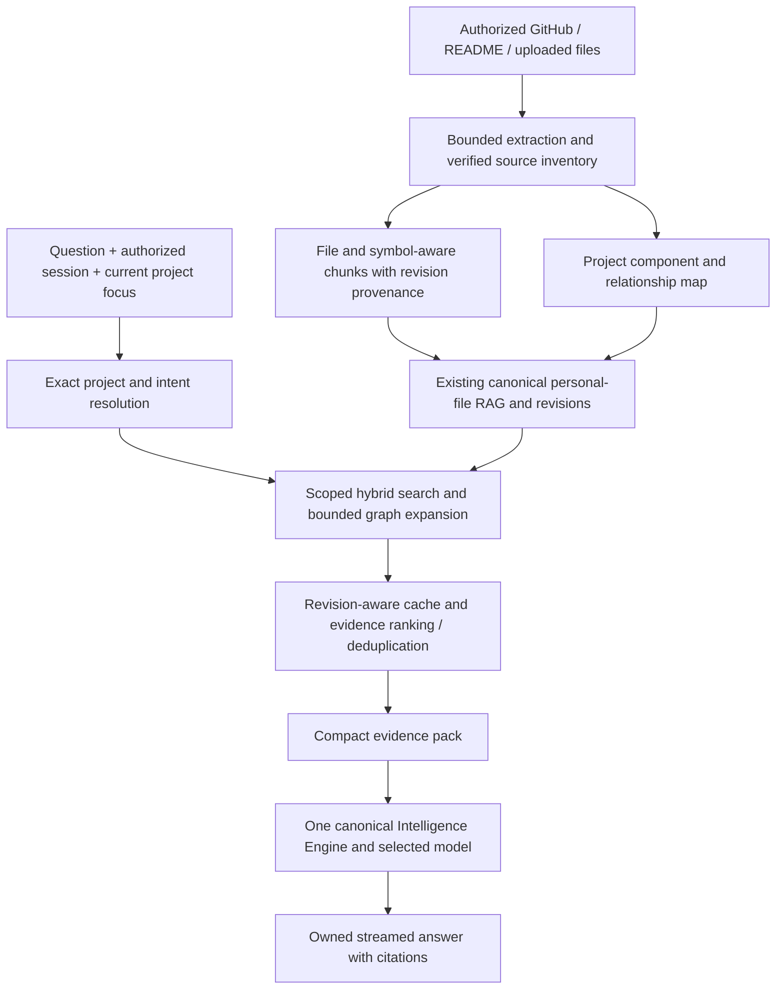
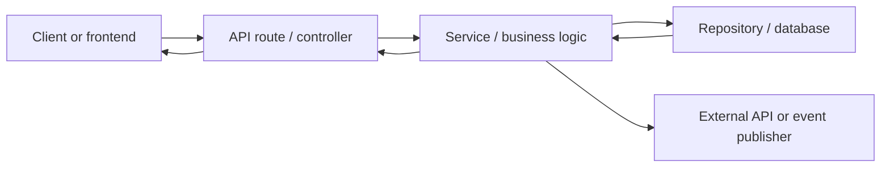
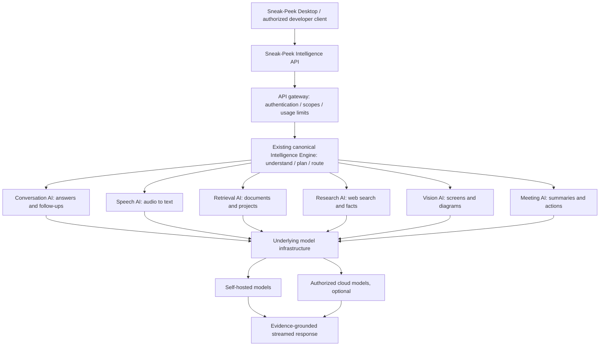

# Sneak-Peek Roadmap 2.0 — consolidated development plan

**Revision: 2026-11-28.** Owner direction: preserve Roadmap 2.0, finish existing production reliability and intelligence acceptance, extend project/research/meeting intelligence, and develop the specialized Sneak-Peek AI model and API platform LAST. This document is a proposed replacement based on GitHub `main` at [`acff7a7a`](https://github.com/Abitesh/Sneak-Peek/commit/acff7a7a5790d51f33025e1dc905817d2be868d6); it does not certify new implementation or change the Git branch. Verify against the current local checkout before applying. Existing task/error IDs and evidence remain valid. New work-package IDs below are roadmap labels, not allocated WORK/TASK/ERR numbers.

**Authoritative baseline from 2026-11-18; owner-approved WORK-0084.** [Task tracker](chatgpt-work/TASK_TRACKER.md) · [Work history](chatgpt-work/CHANGE_LOG.md) · [Error register](chatgpt-work/ERROR_LOG.md) · [Handoff](chatgpt-work/HANDOFF.md). [Roadmap v1 archive](ROADMAP-v1.md) preserves CHG-01–23, evidence, historical plans and unresolved acceptance results. CHG-21 and CHG-22 are retired as milestone gates; genuine unresolved work retains its active owners. Do not resurrect retired sequencing or redo verified work without evidence of a regression.

## Current checkpoint and execution order

WORK-0094 / TASK-0017 (2026-11-26) implements scoped 6.1 continuity/corrections/Unicode identity, 6.2 adaptive budgets, and 6.7 bounded provenance-preserving recall with current source-revision/retention checks. [Report](scripts/audit/work-0094-phase-one-stabilization.md): Electron 9,070 pass / 67 skipped; intelligence 2,263 pass / 9 TODO; Projects/Practice 46 pass; library 391 pass / 1 skipped; scripts 103 pass; new focused tests 11/11 (not added to the broad total); both builds and five typechecks pass; disposable macOS session controls pass both phases with controlled transports. Broad total 11,873 passes, no recorded failures, 68 skips and 9 TODOs. Prior hosted WORK-0093 Build Smoke [45610388362](https://github.com/Abitesh/Sneak-Peek/actions/runs/45610388362) succeeded on macOS and Windows; Windows Electron remains advisory unless current workflow proves otherwise. Latest WORK-0094 hosted [46057360380](https://github.com/Abitesh/Sneak-Peek/actions/runs/46057360380) was in progress at review. Real-model final-answer quality/latency, physical audio, live Hindsight/remote erasure, full fact/relationship controls and platform acceptance remain open.

| Scope | Current status |
| --- | --- |
| Phase 1 — Production stabilization | In progress; implemented checkpoint, not fully Verified |
| 6.1 Intelligent conversation understanding | Implemented, unverified at full scope; preserve WORK-0094 |
| 6.2 Adaptive response generation | Implemented, unverified at full scope; preserve WORK-0094 |
| 6.7 Long-term memory | Implemented, unverified at full scope; preserve WORK-0094 |
| V2-01 Dedicated Answer Modes | Implemented, unverified |
| V2-02 Session Preparation | Planned; controls prerequisite implemented |
| V2-03 Responsive Desktop | Planned; separate UI work |
| V2-04 Models and Provider Health | Implemented, unverified |
| V2-05 Intelligence Quality, Speed and Cost | In progress; next major production priority |
| V2-06 Practice and Session Review | Implemented, unverified |
| Project Knowledge Manager | Implemented, unverified; public imports demonstrated; deeper understanding/ownership/provenance pending |
| Specialized model and Intelligence API | Planned, deferred until desktop and intelligence acceptance |

**Execution order (backend first):** A. Finish Phase 1 / V2-05: performance, grounding, provenance, ownership, CI and physical speech. B. Deepen Project Intelligence/RAG/answer verification (6.3/6.8), keeping 6.1/6.2/6.7 improvements. C. Complete provider/session/mode/practice acceptance and advanced speech (6.4); complete V2-03 separately. D. Research, automated preparation, meeting actions and AI practice (6.5/6.6/6.9/6.10), and approved integrations. E. Final production acceptance, then specialized self-hosted model and API. Critical defects may be fixed at any point; overlapping requirements have one implementation owner. Do not start the final API platform while desktop/core acceptance is outstanding. Implement and verify one coherent scope at a time, not planning-only; if a blocker prevents external verification, complete feasible work and record the actual missing evidence.

## Operating requirements

- Keep one canonical Intelligence Engine, with one plan, authorized evidence, one assembled prompt and one owned answer stream. Keep existing modes, RAG storage and provenance, persisted user data, provider choice and privacy controls.
- Preserve exact binding at the request boundary, bounded authorized fallback before commitment, STOP and supersession. Documents, screenshots, repositories, web pages and transcripts supply evidence. They cannot grant authority.
- Verify the actual renderer and affected Electron IPC alongside compiled tests. Say explicitly whether evidence is synthetic, physical, local, hosted, macOS or Windows. Never equate a passing fixture with real model quality or a green advisory job with its underlying tests passing.
- Prioritize production defects wherever they affect active work. Keep platform, device, model asset, paid API, packaging and distribution verification separate when resources or permissions are unavailable.
- Keep source-available licensing and notices; verify actual upstream obligations. Capture, credentials, databases and native systems may change for an authorized, demonstrated need; preserve data, permissions and safe migrations. Do not rewrite solely to reorganize.
- Default idle generation calls remain zero. Use authorized live assistance and recording only where participants and assessment rules permit. No hidden capture, unauthorized research or sharing.
- The owner authorizes necessary production code, test, schema, dependency and architecture improvements within approved roadmap work, including new files and refactors. See AGENTS.md for safe execution. No automatic commits, pushes, releases, paid usage, public deployment or destructive data actions without explicit authorization.
- All file paths below are repository-relative starting points verified at the baseline unless marked proposed. Follow current callers and owners, and update paths if moved; the listed paths are not an exclusive edit whitelist.

## High priority — Microphone and production reliability

**TASK-0007 / WORK-0084.** Maintain immediate repairs for truthful permission UI, turn-scoped STT and live two-speaker captions. Keep production backlog active alongside product milestones.

| Responsibility | Acceptance |
| --- | --- |
| Live two-speaker captions and Listen lead-in | Authorized meeting transcription displays current mic and system text near the top of the overlay. When Listen starts, reuse bounded recent text once without replaying PCM or starting extra background STT. Clear lead-in at Stop, Analyze, meeting and device boundaries. Ambient AI Chat keeps capture off until a Listen turn. Verify both speaker names and recent interviewer context reach the owning turn and old callbacks never reappear. |
| Stop → fresh Listen | Allocate fresh owner/request and provider instances across both audio channels. Stop discards pending audio, cancels/closes recognizers and rejects late results at source and renderer. Analyze finalizes only the owning turn under a bounded wait and sends authorized transcript to canonical answer pipeline. Rapid cycles and delayed callbacks must pass. |
| Permissions, capture and provider readiness | Report actual OS results and distinguish missing/unknown/restricted permission, opened capture, bad device or zero samples, transcription configuration and provider activity. Recheck after settings changes. Keep ERR-113 physical silence diagnosis open until reproduced. |
| Device and speech robustness | Repeat grant/revoke, default/USB/Bluetooth switching, route loss, sleep/resume, silence and VAD/endpointer cases. Confirm PCM format and capture recovery without crossing identities or duplicating samples. Measure ready latency, ongoing CPU/memory and battery on representative hardware. |
| Speech-to-answer performance | Measure physical speech end → finalized transcript → Analyze → first and final visible answer. Record model readiness, retrieval, dispatch, network or inference, render and cancellation stages. Use approved content and scopes. |
| Other critical reliability | Track toolbar clipping under V2-03, provider recovery under V2-04, and factual, attribution and latency misses under V2-05. Native or platform work needing external verification remains open. |

## macOS installer integrity — TASK-0009

Prevent ARM64 startup crashes caused by incomplete disk images (ERR-119). Size image staging volume for bundled runtime and models, finish nested signing before sealing app, and reject installer if mounted bundle fails framework, architecture or strict signature verification. Launch mounted app with a disposable profile before replacing installed app. Verify replacement in Applications and preserve old bundle for rollback.

**ERR-120.** Keep startup permission checks passive. Persist dismissal of setup guide across launches. Check microphone, screen capture and system audio separately. Verify eligible Core Audio fallback under OS System Audio Recording grant when separate screen check denied. Audio settings meter must exercise selected route. Record macOS reauthorization required for new locally signed build. New packaged release still requires verification after changes.

## Desktop CI and subprocess reliability — TASK-0010

Prove two-slot local code runner closes subprocess output and removes each owned temporary directory on success, execution error, timeout, output overflow and cancellation. Treat cleanup failure as reported execution error. Keep test independent of other processes' temporary directories and exercise parallel workers without reducing CI matrix. Process cleanup and a scrubbed environment are not an OS sandbox; do not run untrusted generated code with unrestricted access to owner files/network.

Keep startup/capture verification separate from fixture compatibility. Confirm portable Windows capture fixtures reach assertions, report actual Windows Electron result even when advisory, and bound real-model test teardown so a failed fixture cannot stall matrix. Record installed macOS and new ARM64 bundle results separately from isolated screen/STT tests. WORK-0087 verified local full macOS suite, fresh ARM64 startup and installed Core Audio meter on Default Speakers. WORK-0093 hosted overall matrix succeeded; inspect actual Windows unit-test result and WORK-0094/latest runs. Physical speech, separate screen grant and Windows GUI remain open. See A4 below for required asset and suite coverage repairs.

## Release ownership and branding — TASK-0011

Configure update metadata, release notes, manual download links and release validation for Abitesh/Sneak-Peek. Require explicitly configured and verified destination for Drive upload. Preserve existing settings and signing compatibility. Verify built updater metadata and real release when available. Audit separately existing speech relay and other service dependencies before replacement. Preserve required upstream attribution and licenses; do not infer commercial redistribution rights from a replacement LICENSE or private repository. Verify before public paid offering.

## Application icon refresh — TASK-0008

Owner supplied official icon for macOS, Windows and Linux. Verify generated multi-resolution assets, runtime paths and actual Apple Silicon application bundle. Windows and Linux installed appearance remain platform checks.

## V2-01 — Dedicated Answer Modes

**Implemented, unverified — TASK-0015 / WORK-0093.** Give each new mode stable identity and explicit context policy using existing mode registry, settings, ContextPlanner, RetrievalCoordinator and ResponsePlanner. Coding / DSA and CS Fundamentals use selected model and permitted turn input with zero private retrieval. Resume & Projects attempts scoped authorized retrieval each turn, including follow-ups, and reports missing support honestly. Preserve General and Technical Interview mixed behavior and saved settings.

**Acceptance.** Verify existing-profile upgrade/relaunch, mode switching with revoked and decoy sources, zero private reads/outbound leaks in no-RAG modes, file/page/revision provenance in Resume & Projects, concise CS explanations, executable coding cases in Python and one alternative language, model pinning, STOP and supersession. Use routed manual chat and relevant live/IPC controls. Track external coverage separately. No retired milestone prerequisite. [WORK-0093 report](scripts/audit/work-0093-modes-models-projects.md). Implementation paths: `electron/services/builtinModes.ts`, `electron/services/ModesManager.ts`, `electron/services/modeSourceContract.ts`, `electron/context-intelligence/policies/mode-policy-registry.ts`, `electron/intelligence/engine/ContextPlanner.ts`, `ResponsePlanner.ts` (same directory), `electron/llm/codeVerification/`.

## V2-02 — Session Preparation

**Planned; session controls prerequisite implemented in WORK-0093.** Owner retired standalone Notes November 24; preserve meetings, profile notes and custom modes. Reuse Launcher, mode settings and current document/meeting stores. Add session types, drafts and four labeled cards: Session & Role, Sources, Model & Language, Answer Preferences. Include company, role, interview round, job description, résumé, authorized projects/documents, answer and transcription languages, style, length, coding language, user instructions, opt-in automation, capture and retention. Session type sets defaults; mode governs answer/retrieval policy.

**Acceptance.** Verify create/reopen/edit/start, existing meeting/profile/custom-mode preservation, accurate source readiness, no capture from drafts, revoked/denied/failed source handling and cross-session isolation. Keep global settings by default. Depends on V2-01 contracts. Paths: `src/components/Launcher.tsx`, `src/components/SessionControlsPage.tsx`, `electron/session/SessionPreferences.ts`, `electron/session/SessionPreferencesStore.ts`, `electron/SessionTracker.ts`, `electron/db/DatabaseManager.ts`, `electron/intelligence/engine/AnswerRequest.ts`, `ProjectFileScope.ts` (same directory). Extend in 6.6.

## V2-03 — Responsive Desktop

**Planned.** Fix clipped toolbar first. Support reliable moving/two-axis resizing, compact and expanded layouts, visible essential controls, readable messages and stable composer. Reuse existing window bounds and appearance infrastructure. Preserve draft, scroll, focus, shortcuts and stream ownership during layout changes. Integrate V2-02 session navigation. Preserve meeting/profile notes; do not resurrect the retired standalone Notes page (clarifies historical "Keep Notes reachable").

**Acceptance.** Test macOS/supported Windows display configurations, small/large windows, edge/multi-display placement, display changes, zoom, long translations, keyboard/screen reader controls, flicker, click targets and STOP while resizing. Independently verified toolbar repairs can ship first. ERR-115 remains open. Paths: `src/components/SneakPeekInterface.tsx`, `src/components/ModelSelectorWindow.tsx`, `electron/ModelSelectorWindowHelper.ts`, `electron/main.ts`. This is a separate UI track; do not use UI redesign as a substitute for backend fixes.

## V2-04 — Models and Provider Health

**Implemented, unverified — TASK-0016 / WORK-0093.** Up to three ordered favorite chat models per configured provider. Answer selectors show eligible favorites; AI Providers owns full account chat selection. Reuse allow lists, app-owned health checks, request snapshots. Keep diagnostics in provider settings; owner November 24 direction removes availability labels from answer selection. Show exact selected and actual answering bindings. Use documented scoped quota data or clearly labeled estimates; never invent balances.

**Acceptance.** Round-trip favorites/preferences through relaunch; pin in-flight binding, switch only on new requests; reject unsupported image or unauthorized fallback routes. Test auth errors, invalid/missing model, rate limit, explicit quota, 503/timeout, bounded retry and stale cache. Require synthetic recovery and applicable authorized text/vision verification. Depends on session config/usable picker. ERR-112 app-level repair evidenced; external availability/fresh recovery timing open. Paths: `electron/services/ProviderStatusRegistry.ts`, `electron/services/providerStatus.ts`, `electron/llm/modelSelectionCatalog.ts`, `electron/utils/modelFetcher.ts`, `electron/LLMHelper.ts`, `electron/intelligence/engine/CanonicalRuntime.ts`, `GenerationController.ts` (same directory), `src/utils/configuredModels.ts`, `src/components/settings/AIProvidersSettings.tsx`. No silent downgrade to meet latency.

## V2-05 — Intelligence Quality, Speed and Cost

**In progress — TASK-0012 / WORK-0089–0094.** Concurrent authorized retrieval and zero-LLM built-in seeding implemented with regressions. Earlier prepared local cohorts met scoped timing/factual targets. WORK-0090/0091 real interview checkpoints miss latency and factual/completeness acceptance; WORK-0093 local 3B-model still fails. WORK-0094 scoped continuity, adaptive budgets and bounded memory implemented; final real-model quality and timing not yet measured. Physical rapid-fire, hosted/provider coverage and resource evidence open. Improve actual retrieval, attribution, correctness, latency and tokens using canonical stores/evaluation suites. Deterministic turn triage and duplicate suppression first. Small background models only after measured quality gains, privacy review and resource/usage budgets. Default idle generation calls zero.

**Acceptance.** Preserve frozen and expanded benchmarks, previous misses and negative assertions. Compare factual reviews with original rubrics; count denied/stale evidence, citation correctness, missing-evidence decisions, repeated turns and stage latency. Approved healthy ready workload: ≥90% factual quality, p95 ≤2 s useful visible text, complete useful short follow-up ≤3 s and longer answer ≤6 s. Rapid-fire target about 1 s to first useful visible text, p95 ≤2 s. Separate cold readiness/uninterrupted cold results, cloud recovery, post-STT Analyze and physical speech-to-paint. Do not cut necessary content or redefine a prefix as completion; explicit exceptionally long/code requests may need more time and must be reported separately, not silently excused. No threshold change without evidence and owner approval. Detailed execution in A1–A3, 6.1–6.4, 6.7–6.8 below.

## V2-06 — Practice and Session Review

**Implemented, unverified — TASK-0014 / WORK-0091.** Text-first practice, local question banks, saved drafts, optional canonical AI feedback, exact saved-meeting review implemented. Full acceptance remains open pending regression, real-provider quality/privacy and relevant platform checks. Historical November 21 stop superseded by owner resumption. Reuse session state and canonical action pipeline. Mark hypothetical examples and separate feedback from supported facts.

**Acceptance.** Preserve practice/meeting state across relaunch; question banks without audio/cloud calls; respect scopes, selected provider, retention. Validate optional feedback and missing-evidence responses. Depends on session/mode and quality/cost contracts. Voice interviewer/external job integrations are new scoped work in 6.10 or later. Paths: `electron/practice/PracticeService.ts`, `electron/practice/MeetingReview.ts`, `electron/practice/practiceIpc.ts`, `src/components/PracticePanel.tsx`.

## Project Knowledge Manager — TASK-0013 / WORK-0091–0093

**Implemented, unverified; owner-approved 2026-11-21.** Profile Intelligence → Projects adds stable identities/aliases, manually authored facts/contributions, bounded public GitHub import, supporting documents, locally held diagrams, source states, explicit interview availability, edits/reindex/deletion. Searchable evidence stays in canonical personal-file RAG/revision storage; project association/practice tables are not a second retrieval or answer engine. Preserve résumé project summary. No ownership/authorship inferred from repository URL.

**Acceptance.** Prove stable IDs across edits, current revision/provenance, unique aliases, generic document names, conflicting/absent evidence, no cross-project retrieval, disabled/deleted-source rejection (including parked streams), original-file preservation, indexing failure/retry, Unicode/source files, scanned/partial PDF states, diagrams only after explicit analysis, and relaunch. WORK-0093 real public imports succeeded (Linkship 40 files, 19.48 s, 11 eligible omissions; RealWorld 20 files, 9.68 s, 14 omissions; later RealWorld partial 403). Prior anonymous 403 remains historical evidence. Offline safe/decoy fixtures separate from live quality acceptance. Authenticated private import unimplemented; authorized pasted/uploaded docs remain available. Complete real answer benchmark and expanded A2/A3/6.3 below.

**Dependency scope.** Approved project/source selection and text practice reuse General/Technical modes and canonical request/source contracts. Small prerequisites do not complete V2-01/V2-02 or waive V2-05 quality/timing. Practice independently testable without audio/cloud; real feedback quality/scope separately accepted. V2-05 remains In progress.

## Retired milestone work and ongoing maintenance

| Historical record | Active owner and next evidence |
| --- | --- |
| CHG-21 / TASK-0004. C21-AC1 passed locally. C21-AC2 remained open. | V2-05 carries ERR-102 ambiguous meeting attribution, ERR-104 ready/cold latency, ERR-110 Listen factual precision. Repeat frozen, expanded and visible workloads. Microphone track carries physical STT timing and ERR-113 intermittent silence. |
| CHG-22 / TASK-0005. Scoped dead screenshot cleanup verified locally. Full C22-AC1/AC2 remained open. | Maintenance ERR-114: migrate legacy manual body's source assertions to current production privacy, grounding, provider and lifecycle behavior before deletion. Audit callers/IPC/data/rendered equivalence. Keep exposed compatibility/shared transports until replacements and users proved. |
| CHG-23 / C23-AC1–6 and FEAT-003/004 | V2-01 owns modes and acceptance; historical ordering retired. |
| ERR-115 toolbar clip | V2-03; fix reachability independently of native resizing and verify affected displays. |
| ERR-116 permission/STT copy, ERR-117 stale Listen, ERR-118 permission display | TASK-0007; track local repairs and owner/production device checks. |
| Previously untested Windows GUI, paired Phone Mirror, real credentialed text/vision, packaged launch, hosted Build Smoke | Separate platform/release/maintenance checks. Local/synthetic results do not verify these environments. |

Historical measurements: [quality evaluation](scripts/audit/chg21-quality-evaluation.md), [surface map](scripts/audit/chg20-surface-map.md), [error log](chatgpt-work/ERROR_LOG.md). The following sections extend the existing roadmap, not replace its acceptance contracts.

# Expanded backend execution plan (owner requirements, 2026-11-28)

## A1 — Biggest problem: Intelligence Engine performance (P0, V2-05)

**Owner requirement:** Fastest recorded completion **25.9s**, slowest **36.7s**; improve short answers to **3 seconds** and longer answers to **6 seconds**. These are historical intermediate real-model llama3.2:3b renderer results from WORK-0093, not a measured post-WORK-0094 baseline. First-character proxies were 21.3–32.4 s; actual useful text requires semantic review. The latest work improved planning, not yet measured final inference speed. Reproduce before changing anything and retain the original misses. Earlier prepared WORK-0089 tests are useful controls but not substitutes for this workload.

| Area | Required improvement | Starting files / implementation |
| --- | --- | --- |
| Prompt assembly | Reduce unnecessary instructions and repeated context | `electron/intelligence/engine/PromptAssembler.ts`, `SneakPeekIntelligenceEngine.ts` (same directory), `electron/llm/promptSystemV2.ts`: profile actual assembled prompts, deduplicate rules/evidence, bound history and use compact relevant context; preserve policy and question. |
| Model prefill | Measure time spent processing the assembled prompt before generation | `electron/intelligence/engine/CanonicalRuntime.ts`, `electron/LLMHelper.ts`, `electron/llm/ollamaContext.ts`: capture prompt tokens, provider timings where supported, cold load and prefill separately; investigate authorized prompt-prefix caching only with stable context and tenant/source isolation. |
| Model generation | Benchmark suitable configured models for speed and accuracy | `electron/intelligence/engine/GenerationController.ts`, `LiveAnswer.ts`, `electron/llm/modelSelectionCatalog.ts`, `electron/services/ProviderStatusRegistry.ts`: compare exact selected ready model, quantization, context size, reasoning support and decode throughput; no silent fallback or reduced accuracy to pass. |
| Evidence selection | Include sufficient relevant information without flooding prompt | `electron/intelligence/engine/ContextPlanner.ts`, `RetrievalCoordinator.ts`, `CanonicalRagRetrievalAdapter.ts`, `electron/rag/buildRagEvidencePack.ts`: exact scoped retrieval, rank/deduplicate, compact proof-carrying evidence and bounded top-k; preserve necessary requested components. |
| Answer validation | Prevent unsupported personal claims and incomplete answers | `electron/intelligence/engine/ResponsePlanner.ts`, `PromptAssembler.ts`, `electron/llm/codeVerification/`: use deterministic checks and representative factual rubrics; optional expensive checks only when justified, never mask missing facts. |
| Conversation understanding | Reliably distinguish short follow-ups from detailed new questions | `electron/intelligence/engine/ProjectFileScope.ts`, `ResponsePlanner.ts`, `electron/context-intelligence/question/conversation-state-store.ts`, `electron/llm/sessionFollowupResolver.ts`: preserve WORK-0094 and extend only measured misses. |
| Auto Answer | Measure real speech-to-visible-answer latency | `electron/intelligence/autoAnswer/`, `electron/intelligence/LiveTranscriptBrain.ts`, `electron/audio/ListenSession.ts`, `src/components/SneakPeekInterface.tsx`: instrument physical speech end, STT finalization, judge/dispatch, plan/retrieval, model and useful first/final paint; test overlap and STOP. |

### Reconcile SessionPreferences.ts timing

Current source at baseline: `electron/session/SessionPreferences.ts` (`sessionAnswerGuidance`). This is still present after WORK-0094.

| Response type | Current prompt target | Required behavior |
| --- | --- | --- |
| Short | 3 seconds | Complete useful short answer within 2–3 s on approved ready workload. |
| Medium | 6 seconds | Complete within 6 s. |
| Long | 9 seconds | Remove inconsistent default 9 s target for live interview answers; complete a concise but sufficient answer within 6 s. |
| Coding | 10–12 seconds (useful opening 4 s) | Reconcile with 6 s live-answer target; explicitly requested large code/design outputs require separate workload/reporting and owner-approved exceptions, never hidden truncation. |

A timing instruction in a prompt is not a performance mechanism. Align session settings, adaptive ResponsePlanner, provider capabilities and actual output budgets without overriding explicit requested content. Preserve explicit user duration and style precedence; report when an explicit long request cannot be completed within six seconds. Target 1–2 s useful visible text for rapid-fire (p95 ≤2 s); simple ready greetings aim ~1 s. Do not use speculative partial answers, artificial delays, fake paint events, hidden quality downgrade, or stop at a token count with incomplete content.

### Implementation workflow and acceptance

1. Baseline current retained code with the eight-question sequence below, frozen/expanded rubric and unseen projects. Record commit, machine/available RAM, provider/model exact ID, parameters, prompt tokens, output tokens, readiness, concurrent workloads and environment. Separate user-observed timing from instrumentation. Use approved local/synthetic data; hosted and physical runs require authorized resources/consent.
2. Trace every stage with a monotonic request ID. Record p50/p95/max, cohort size, success/failure and factual/completeness per turn, first useful visible text (not first character), final renderer paint, tokens, retrieval hit/miss, model prefill/decode where available, RAM/CPU and cancellation. Missing provider telemetry stays unknown. Test warm, cold, recovery, conversation-only, RAG, screen, manual, simulated and actual speech separately. Do not pool cohorts to hide a miss.
3. Optimize the largest measured stage first. Benchmark compact prompt, evidence selection, preloading with no idle generation, provider-supported prefix/KV caching and suitable explicitly selected models. Retain only changes with measured benefit and no privacy, correctness, completeness or regression loss. Test low-memory and competing local STT/embedding model loads. No unapproved model downloads or billable calls.
4. Acceptance: ≥90% factual quality on approved representative workload and preserve frozen/expanded rubrics; p95 ≤2 s first useful visible text, complete short ≤3 s and longer ≤6 s on approved healthy ready workload; count every miss and report maximum. Test requested examples, natural first-person answers, correct topic changes, all requested subparts, no invented personal claims, zero default idle calls, zero private retrieval in no-RAG modes, unchanged source authority, model commitment, STOP and supersession. Regressions and desktop checks must pass. Record unavailable providers/physical hardware separately and leave acceptance open rather than waiving it.

**Owner's historical real interview regression sequence (WORK-0090 intake):** use actual session context, selected/authorized projects and same provider/settings where available; not hardcoded responses.

| Question | Historical owner-observed time | Expected outcome |
| --- | ---: | --- |
| Hi | 9.08 s | Natural short greeting, no unnecessary generation or retrieval. |
| What is system design? Can you solve any system design problem I give you? | 6.14 s | Plain definition and willingness/approach; answer both parts. |
| Explain your projects and implementations to someone with no coding knowledge | 10.20 s | Grounded plain-language Linkship and Geospatial Dispatch descriptions and analogies. |
| Now explain those projects technically | 8.72 s | Same projects, technical stack and implementation; no generic reset. |
| Please elaborate Geospatial | 9.83 s | Resolve Geospatial Dispatch; explain project, not dictionary definition. |
| No, I asked about your Geospatial project | 4.27 s | Correct topic and persist focus. |
| Why did you use Spring Boot instead of alternatives? | 8.07 s | Project-specific tradeoffs; distinguish documented choice from a possible rationale. |
| What are Spring Boot and OSRM used for in your project? | ~4 s | Correct distinct responsibilities supported by repository/user facts; do not say context is missing if available. |

Also test "Explain the flow", "How does the database work?", "What alternatives did you consider?", multilingual names, switching to unrelated DBMS/CS topics, overlapping rapid-fire, ambiguous project aliases, explicit correction, deleted/disabled source, conflicting docs, missing evidence and fresh session. Use unseen projects to rule out memorized fixtures. The model must speak naturally (not always "Good interview answer" or generic bullets), with brevity for small follow-ups and technical depth for longer ones. Do not attribute a feature or contribution to the user unless supported.

**Expected final outcome:** responsive, accurate project-aware live/manual answers at the actual renderer, transparent route limits, meaningful before/after metrics, no new regression. If selected hardware/model cannot meet target, isolate capacity bottleneck and offer supported alternatives without changing selection automatically. V2-05 remains open until required evidence passes.

## A2 — Project Intelligence needs further improvement (P0/P1, TASK-0013 / 6.3)

App path: **Profile Intelligence → Projects** (and authorized session source selection; My Files for supporting documents). Runtime path: project import/save → canonical personal-file ingestion/index → exact project resolution → authorized retrieval → canonical generation. GitHub URL is an actual knowledge source, not merely an optional label or hyperlink. Adding a URL automatically imports and analyzes evidence asynchronously, before interview-time answering. A project name, alias or relevant follow-up must route to that project's current authorized evidence without making GitHub requests at answer time.

| Feature | Current limitation | Improvement |
| --- | --- | --- |
| Architecture understanding | Mostly syntax and pattern-based extraction | Build stronger component relationship maps. |
| Request flow | Individual routes, imports and symbols | Connect API → service → database → response. |
| Large repositories | Maximum 40 imported files at baseline | Prioritize additional relevant files incrementally; bounded, transparent coverage rather than unlimited blind ingestion. |
| Repository updates | Explicit refresh | Efficient changed-file reindexing using commit/blob hashes. |
| Private repositories | Not implemented | Authorized, read-only authenticated import. |
| Technology decisions | Model sometimes invents rationale | Separate documented facts from possible explanations. |
| Retrieval caching | Revision-aware cache exists | Measure hit rates and real latency improvements. |

**Starting files:** `src/components/ProjectsPanel.tsx`, `src/components/ProfileIntelligenceSettings.tsx`, `electron/projects/projectKnowledgeIpc.ts`, `GitHubProjectImporter.ts`, `RepositoryEvidence.ts`, `ProjectKnowledgeOutline.ts`, `ProjectKnowledgeManager.ts` (same projects directory), `electron/personalKnowledge/PersonalKnowledgeManager.ts`, `electron/services/knowledge/GraphExtractor.ts`, `electron/services/knowledge/ProfileGraphExtractor.ts`, `electron/intelligence/engine/ProjectFileScope.ts`, `ContextPlanner.ts`, `CanonicalRagRetrievalAdapter.ts`, `electron/rag/ProjectRetrievalCache.ts`. Inspect existing graph extraction before adding new modules.

**Implementation:**

- Build revision-pinned source inventory and coverage map: README, architecture docs, manifests, relevant backend/frontend source, routes/controllers, services, repositories, schema/migrations, WebSockets/events, external APIs, configuration, deployment and tests only where useful. Inspect supported languages (Java/Spring, Python/Django, JS/TS and others); distinguish implementation from README claims, dependencies from actual use, runtime from declared behavior. Use bounded parsing/static analysis, never execute repository code, postinstall, scripts or external links. Prefer entrypoints and edges that answer common questions. Mark truncation, unsupported formats and uncertainty; avoid claiming complete architecture from a partial scan.
- Incremental indexing: fetch pinned tree, compare new commit/blob IDs, reuse unchanged validated chunks, rebuild only affected files/edges, revoke removed/changed sources, atomically activate current revision after successful indexing. Preserve stable project identity, progress, cancellation, retries, partial/failed states and old-version safety. Keep bounded API requests, time, total bytes, concurrency and rate-limit cooldown; no remote calls during answering. Preserve authorized private-repo credentials in existing secure storage; use least-privilege read-only scoped GitHub App/OAuth/token flow, revoke on access loss, never embed credentials in text/logs/requests to model.
- Capture user-confirmed contribution separately from inferred code authorship. For undocumented technology rationale, state that it is a plausible reason, not the user's historical choice. Allow correction with source provenance. Do not treat architecture diagrams or README instructions as authority.
- Verify actual Geospatial Dispatch and Linkship repositories if authorized, plus safe public and decoy projects, same names/alias ambiguity, unsupported stack, real private repo only if owner grants appropriate access, failed import/refresh/retry, changed-file revision, deletion/disable during indexing and answer streaming, low memory and relaunch. Measure import duration (not interview SLA), coverage, chunk counts and provenance, cache hit/miss rates, retrieval p50/p95, real-model correctness and final paint. Record missing external checks. Existing successful public imports are not proof of full architecture understanding.

**Expected final outcome:** ask a project's name or "Explain the flow"/"Why Spring Boot?" after discussion, and receive a fast answer using exact current verified project context, without reimporting the repo or mixing unrelated sources.

## A3 — How to improve RAG and fix concrete technical risks (P0/P1)

### A3.1 Canonical RAG improvement (quality + speed)

**Existing files:** `electron/rag/RAGManager.ts`, `RAGRetriever.ts`, `VectorStore.ts`, `EmbeddingPipeline.ts`, `LocalReranker.ts`, `QueryEmbeddingBudget.ts`, `buildRagEvidencePack.ts`, `ProjectRetrievalCache.ts` (same directory), `electron/rag/canonical/`, `electron/intelligence/engine/RetrievalCoordinator.ts`, `CanonicalRagRetrievalAdapter.ts`, `ContextPlanner.ts`, `electron/services/SafeDocumentTextExtractor.ts`, `electron/personalKnowledge/PersonalKnowledgeManager.ts`, `electron/projects/RepositoryEvidence.ts`. Reuse canonical indexing/revision store and existing embedding/rerank models; do not create another RAG answer engine or add a graph DB by default. See 6.3 for component mapping.

- Extraction: preserve headings, code symbols, file/page/line offsets, tables, Unicode and partial states. Add bounded opt-in OCR for scanned PDFs/images where supported; do not silently mark incomplete extraction Ready. Use existing screen OCR adapters when appropriate without conflating screen capture permission with document access. Reindex only changed versions. Keep ingestion async, never wait for whole repository during answer. Test source files, large/invalid/binary input, scan, page boundaries and stale/deleted revisions.
- Search: deterministic project names/aliases/component terms first, exact authorized IDs before candidate limits, lexical+semantic search and reranking only when necessary, bounded relationship expansion, query-specific structural chunks, dedup, enough source diversity. Cache completed retrieval keyed by user/session/scope/project/source revisions/content hash/query/model+embedding policy; invalidate on corrections/deletion/disable/expiry. No cross-user cache, answer cache with private stale data, or shared in-flight request ownership. Cache misses and denied/revoked sources remain fail-closed.
- Measure recall@k/precision@k or equivalent evidence coverage against human-reviewed ground truth, citation validity, no-evidence decisions, duplicate chunks, cold/warm p50/p95, cache hit/miss, prompt size, token use and factual answer quality. Include negative canaries for unrelated projects, generic CS mode, conflicting evidence, source changes and adversarial embedded instructions. Only retain changes with demonstrated quality or speed gain; do not add complexity just to call it GraphRAG.

**Expected outcome:** a compact, fresh, relevant evidence pack in low-hundreds-of-milliseconds where feasible (measure, do not claim as achieved), with accurate technical flow and traceable source locations, less prompt bloat and no source leaks.

### A3.2 Repository provenance integrity — prior static finding, verify current source

`electron/projects/RepositoryEvidence.ts` parses commit/source markers from formatted text. `electron/projects/projectKnowledgeIpc.ts` project save can skip importing when supplied README contains expected markers. Manually edited text could potentially be interpreted as imported repository evidence; this is a source-level risk requiring dedicated regression, not a reproduced exploit.

**Fix:** separate trusted, import-generated metadata (repository identity, revision, blob SHA, source path, original line range, content digest, import origin) from user-editable README and notes. Use authenticated fetch result/validated persisted import record to decide freshness, not magic markers. Validate repository/commit/blob identity and source locators before citations. Keep manual data clearly user-authored; migrate old envelopes without claiming unverified provenance, reimport if needed. Redact secrets without shifting line numbering (preserve line map or placeholders). Reject forged markers, invalid paths/SHAs and stale citations, keep display of legitimate user content. Test malicious/accidental forged envelope, edit, reindex, identical marker in manual note, redacted multiline secret, partial fetch, old revision, and exact GitHub line references. No credentials in index or logs.

**Expected outcome:** only genuinely imported, verified metadata creates repository citations; no spoofed commit/line location and no private secret exposure. Preserve canonical revision and source authority.

### A3.3 Project deletion and document ownership — prior static finding, verify current source

`electron/projects/ProjectKnowledgeManager.ts` sources include `owned`, but deletion at baseline removes an indexed file if no other project references it, without consulting `owned`. Existing tests preserve the original external file and shared project source; independent My Files ownership needs a separate contract. Avoid unintended deletion of separately managed knowledge.

**Fix:** distinguish project-created application copy, pre-existing My Files item, shared link and original external file. Reconcile attachment ownership with `electron/personalKnowledge/PersonalKnowledgeManager.ts`, project associations, canonical source/revision store and cache epoch. Keep independently managed files and unrelated project links; delete only exclusively project-owned application copies after last authorized reference. Revoke removed project association/availability immediately including active/parked requests, without granting generic access to a revoked private source. Define explicit semantics when user intentionally deletes a shared file. Preserve original external file/repository; filesystem/database cleanup must be transactional or recoverable with visible errors. Test independent My Files item attached then project deleted, shared two projects, owned copy, enable/disable, upload race, failed cleanup, restart, old revision and late stream. Use disposable database, never owner data.

**Expected outcome:** project deletion removes its knowledge and links, but does not delete independently managed knowledge or external originals; no stale authorized answer after revocation.

### A3.4 Local-model context allocation

`electron/llm/ollamaContext.ts` prevents previous silent prompt truncation via a conservative character/UTF-8 estimate and bounded windows up to 16,384/32,768 tokens. Larger allocations may increase KV cache and memory pressure. Exact tokenization is model-specific.

**Fix/measure:** inspect current `ollamaContextWindow`, `electron/LLMHelper.ts`, model capabilities and canonical prompt assembly. Measure actual prompt token count where provider reports it, requested context, load/prefill/decode times, RAM/VRAM, OOM, simultaneous STT and embedding workloads; choose smallest safe supported window and compact evidence without removing authority/question. Benchmark Latin and multilingual text, code, long history, oversized prompt and unavailable model. Do not increase limits blindly or silently truncate; report capacity error and allow explicit smaller source set/model selection. Keep cancellation and provider commitment.

**Expected outcome:** no silent leading-instruction loss; lower memory and prefill cost where measured; accurate actionable overflow errors. Compare before/after with identical model and output workload.

## A4 — CI, runtime and production reliability

**P0 CI:** Previous WORK-0092 Windows smoke [45347704821](https://github.com/Abitesh/Sneak-Peek/actions/runs/45347704821) failed because `resources/models/Xenova/bge-reranker-base/onnx/model_quantized.onnx` was missing/empty. WORK-0093 hosted smoke succeeded on both platforms, so do not claim this failure persists; reproduce clean/cache-hit Windows provisioning if needed. Inspect latest WORK-0094 run and actual job steps. Existing workflow at last audit did not invoke `test:projects-practice` or aggregate `test:ci`; verify current `.github/workflows/build-smoke.yml` and `package.json` then add missing enforcement for project/practice/personal-file tests to both platforms. Inspect `scripts/download-models.js`, `scripts/verify-packaged-local-assets.mjs`, cache keys, network/partial download and integrity. Ensure deterministic required-model provisioning with bounded retry and validation, no fake files, no weakened verify step. Windows advisory Electron step: inspect actual failures, fix genuine platform defects and move to enforcing after successful evidence. Keep API smoke opt-in/credential-gated.

**P1 coding execution:** `electron/llm/codeVerification/localRunner.ts`, `verifyCodingAnswer.ts`, `drivers.ts`, language drivers, `cloudRunner.ts`, `verificationEnabled.ts`. Verify Python plus one alternative language (owner prefers Python for coding), correct/incorrect outputs, syntax, timeout, overflow, cancellation, process tree cleanup and shared temp worker isolation. Use controlled fixtures, no untrusted code on owner filesystem/network; require actual sandbox isolation for arbitrary generated code. Check runner capabilities accurately. Do not claim a scrubbed environment is a sandbox.

**P1 physical audio:** see TASK-0007 and 6.4; test grants, default/USB/Bluetooth, speaker separation, speech pause/resume, sleep, silence, device disconnect and stale callbacks on actual hardware. Confirm ERR-113 root cause before claiming fix.

**P1 providers/session/meetings/data:** finish V2-01/02/04 acceptance, real meeting summaries/search, migration recovery, source isolation and provenance. Existing `electron/db/DatabaseManager.ts` and session store need versioned migrations, old-profile upgrade, rollback/recovery and no unintended notes/meeting/profile deletion. Use disposable migration fixtures, backup plan for real data. `electron/services/meeting/MeetingSummaryV3.ts`, `MeetingSummarySchemaValidator.ts`, `CrossMeetingRecall.ts`, `electron/intelligence/engine/SavedMeetingEvidence.ts`, `RagIpcStream.ts`, `src/components/MeetingDetails.tsx`, `MeetingChatOverlay.tsx`, `GlobalChatOverlay.tsx`, `TopSearchPill.tsx`: verify actual summary/search, timestamp/speaker attribution, no matching evidence, fast completion races, errors, scope, model selection and relaunch. Fix genuine defects rather than simply adding retry UI.

**P2 Phone Mirror/resources/packaging:** `electron/services/PhoneMirrorService.ts`, `phoneMirrorClient.ts`, `electron/intelligence/engine/PhoneMirrorRequest.ts`, `src/components/settings/PhoneMirrorSettings.tsx`: verify physical handset pairing, auth, current scopes, selected model, deletion, network loss and revocation; no hidden capture. Measure long session CPU/RAM/battery, model residency, leak/teardown and cache growth. Verify fresh installed macOS ARM64 and supported Windows packages, signing/framework/assets, permissions, updates, rollback and no dev-server reliance. Keep native/architecture checks separate. See TASK-0009/0010/0011/0008.

**Acceptance:** repeat full affected suites on final retained tree, actual desktop/IPC and hosted jobs where accessible; pass model asset integrity, report skips/TODO/advisory, real vs controlled, installed vs dev, physical vs injected, local vs hosted. No threshold changes or reduced CI matrix merely to pass.

## A5 — Other backend development and debugging remaining (priority matrix)

| Priority | Area | Remaining work | Owner / cross-reference |
| --- | --- | --- | --- |
| P0 | Intelligence | Real-model accuracy, latency and complete answers | V2-05 / A1 |
| P0 | Auto Answer | Physical speech, overlapping questions, duplicates and response timing | TASK-0007 / 6.4 / A1 |
| P0 | RAG | Project grounding, evidence coverage and provenance integrity | TASK-0013 / A2–A3 / 6.3 |
| P0 | CI | Missing Windows model assets (historical failure; prevent recurrence) and missing test-suite coverage | TASK-0010 / A4 |
| P1 | Audio | Microphone silence, device changes, sleep/resume and STT recovery | TASK-0007 / 6.4 |
| P1 | Providers | Actual account access, rate limits, quota failures and fallback | V2-04 |
| P1 | Session backend | Saved interview drafts, per-session source selection and isolation | V2-02 / 6.6 |
| P1 | Coding mode | Execute generated solutions in Python and alternative languages | V2-01 / A4 / 6.8 |
| P1 | Meeting intelligence | Real summaries, meeting search and global search | V2-05 / A4 / 6.9 |
| P1 | Data management | Project ownership, deletion and database migration verification | A3.3 / A4 |
| P2 | Practice | Real-model feedback quality and privacy | V2-06 / 6.10 |
| P2 | Phone Mirror | Physical handset and project-scope verification | A4 / ERR-143 |
| P2 | Resources | CPU, memory, battery and long-session stability | A1 / A4 |
| P2 | Packaging | Fresh installed macOS and Windows application verification | TASK-0009/0010/0011 |
| P2 | Maintenance | Safe removal of obsolete compatibility paths | ERR-114 / A6 |

## A6 — Codebase maintainability (incremental, after production defects)

Large central files such as `electron/ipcHandlers.ts`, `electron/main.ts` and `electron/LLMHelper.ts` should gradually become smaller responsibility-specific modules. Organize IPC registrations around intelligence, meetings, projects, providers, sessions and audio, following existing Projects and Practice registrar pattern (`electron/projects/projectKnowledgeIpc.ts`, `electron/practice/practiceIpc.ts`). Extract only demonstrated isolated responsibilities; keep stable IPC names, sender/authorization validation, preload signatures, persisted settings/data, lifecycle, cancellation and provider behavior. Trace importers/callers, registration, migrations, native dependencies, renderer consumers and tests before deleting paths. Migrate legacy assertions to actual behavior and document active replacement, not a broad arbitrary rewrite. Maintain all compatibility contracts until verified safe to remove. Do not claim smaller files make inference faster. Acceptance: before/after behavior/IPC contracts, focused and full relevant tests, build, desktop lifecycle, no dead duplicate owners. Update PROJECT_TREE only when structure changes and record justified extraction. Expected outcome: easier debugging and safer feature changes, not cosmetic LOC reduction.

# 6. Backend intelligence improvements — extended roadmap

These ten scopes are linked to existing V2 milestones. Preserve completed implementation checkpoints (WORK-0094 6.1, 6.2, 6.7); finish only open criteria or evidenced regressions. Each includes purpose, file path, implementation and expected final result.

## 6.1 Intelligent conversation understanding

**Highest priority · Improve existing functionality · WORK-0094 implemented checkpoint, full acceptance open.**

**What it does:** Understands the actual meaning of a conversation rather than treating every sentence as a completely new question. For example, after explaining Geospatial Dispatch, the assistant understands that "How does the database work?" refers to that project's database.

**What to develop:** Persistent conversation topics, project/entity resolution, question classification, correction handling, multilingual context and accurate follow-up detection.

**Paths:** `electron/context-intelligence/question/conversation-state-store.ts`, `conversation-state.ts`, `ProjectOverviewIntent.ts` (same directory), `electron/intelligence/engine/ProjectFileScope.ts`, `ContextPlanner.ts`, `ResponsePlanner.ts`, `electron/llm/sessionFollowupResolver.ts`, `electron/intelligence/ConversationMemoryService.ts`. Current focused tests `electron/intelligence/engine/__tests__/PhaseOneContinuity.test.mjs`.

**Implementation:** Preserve current Unicode identity and explicit correction/implicit-component logic. Extend deterministic entity resolution across repeated turns and compaction, ambiguous names, multilingual referents beyond narrow Hindi/Spanish, genuine topic changes, speaker identity and canceled/failed turns. Use conversation focus only as a retrieval hint; current permitted project IDs remain authority. Avoid extra LLM classification for obvious follow-ups. Use scoped clarification when genuinely ambiguous. Test unseen names, pronouns, multiple projects, long compaction, switches, corrections, revoked sources and no private mode. **Expected:** correct and stable topic resolution and fast, grounded natural follow-ups; no prior-context leak. Prove real-model quality and latency under A1; no claim of universal multilingual coverage.

## 6.2 Adaptive response generation

**Highest priority · Improve existing functionality · WORK-0094 implemented checkpoint, real acceptance open.**

**What it does:** Answers straightforward questions quickly while spending more reasoning effort on complicated questions. A greeting should not require the same processing as distributed-system design.

**What to develop:** Deterministic fast paths, question-dependent reasoning budgets, compact prompts, adaptive answer length and genuinely useful streaming.

**Paths:** `electron/intelligence/engine/ResponsePlanner.ts`, `PromptAssembler.ts`, `SneakPeekIntelligenceEngine.ts`, `CanonicalRuntime.ts`, `LiveAnswer.ts`, `GenerationController.ts`, `electron/session/SessionPreferences.ts`, `electron/LLMHelper.ts`, `electron/llm/ollamaContext.ts`, `electron/intelligence/engine/__tests__/PhaseOneAdaptiveResponse.test.mjs`. Preserve existing bare-definition, design/debug/coding and explicit duration precedence. Align A1 timing; map only supported provider reasoning knobs; avoid assuming all adapters honor them. Fast paths must be semantically narrow, no hardcoded project answer. Benchmark actual useful paint, completion and accuracy across complexity; preserve code completeness, language, preferences, STOP and exact model. **Expected:** short conversational responses within 3 s and useful longer within 6 s on approved capable ready workload, rapid first useful text p95 ≤2 s. No universal guarantee without evidence.

## 6.3 Project Knowledge Graph

**Major opportunity · Extend Projects Manager · Planned deeper graph, current source map implemented.**

**What it does:** Understands how different parts of a software project connect, rather than simply remembering pieces of its README.

**What to develop:** Source-code analysis, API relationships, component dependencies, database relationships, implementation flows and verified technical decisions. Extend current RAG, not an independent answer engine.

**App:** Profile Intelligence → Projects, use during authorized project questions and session prep. **Paths:** A2/A3; additionally `electron/services/knowledge/GraphExtractor.ts`, `ProfileGraphExtractor.ts`, `EvidenceAssembler.ts`, `RetrievalEvidencePack.ts` (same directory). Proposed schema extension in existing SQLite canonical/project metadata, not required external graph DB.

This is a candidate graph shape, not a claim every project has these components. Build nodes for modules/symbols/API routes/tables/technologies and typed edges (calls, imports, reads/writes, publishes, subscribes, implements); attach source ID, revision, original file/line, relation type and confidence. Derive edges from actual declarations/calls or documented evidence; flag dynamic/unresolved relationships, conflicting README/code, partial import. Do not infer personal contribution. Query relevant subgraph and neighboring canonical chunks under exact project scope, bound traversal and evidence size; measure against existing hybrid baseline and reject if latency/accuracy worsens. Rebuild only changed edges on reindex; delete with project and revoke stale access. **Acceptance:** prove end-to-end actual request flow for at least two different stacks (e.g., Java/Spring + Python/Django), source-located edges, missing/ambiguous relationships, decoy projects and real answers. **Expected:** explain actual API → service → database → response or alternative event flow grounded in source, fast enough for follow-up questions.

## 6.4 Advanced speech intelligence

**Highest priority · Reliability and performance · Extend TASK-0007.**

**What it does:** Understands when a person has finished speaking, who is speaking, and whether they asked a meaningful question.

**What to develop:** Streaming speech recognition, speaker separation, voice activity detection, adaptive end-of-speech detection, background-noise handling and project-specific technical vocabulary. Crucial for rapid-fire.

**Paths:** `electron/audio/ListenSession.ts`, `SystemAudioCapture.ts`, `speechEdge.ts`, `openaiTranscriptTurnCoalescer.ts`, `whisper/vadProcessor.ts` (relative to audio), `native-module/src/vad.rs`, `electron/intelligence/LiveTranscriptBrain.ts`, `autoAnswer/`, `electron/llm/transcriptQuestionExtractor.ts`, `transcriptCleaner.ts`, `src/components/ui/RollingTranscript.tsx`. App: authorized meeting captions, Listen/Analyze/STOP, Auto Answer, Audio settings. Use current mic/system channels; diarization must label unknown rather than invent speaker. Adapt endpoint thresholds with measured false splits/merges; avoid background duplicate STT, preserve owner-specific lead-in and fresh recognizers. Improve technical vocabulary only if supported by selected STT provider, no private metadata sent without permission. Test real speech incl. overlap, interrupted questions, noise, accents, technical terms, silence, echo, disconnect, sleep, permission changes and cancellation. **Acceptance:** measure WER or task-specific transcription errors, speaker attribution, false triggers, question-detection and speech-to-visible timing; report physical vs injected separately. **Expected:** accurate live captions and low-latency meaningful questions without duplicate/stale answers or unauthorized capture.

## 6.5 Research Engine

**New capability · Extend existing company research and search seams (P1).**

**What it does:** Retrieves current information that an AI model might not know: research a company, products, current technical documentation or upcoming discussion.

**What to develop:** Search-provider adapters, source ranking, citation extraction, freshness checks and research caching.

**Paths:** `electron/services/resolveCompanySearchProvider.ts`, `premium/electron/knowledge/CompanyResearchEngine.ts` (existing premium path; verify license/availability), `electron/intelligence/engine/ContextPlanner.ts`, `RetrievalCoordinator.ts`, `CanonicalRuntime.ts`, `src/components/ProfileIntelligenceSettings.tsx` (Company Intel / search settings), current global search. Inspect existing Tavily/company-search configuration before implementing a proposed shared research adapter. Respect product entitlement and provider terms. Explicitly authorize web queries and minimize private context; do not transmit full resumes/transcripts/credentials to search. Fetch bounded allowlisted HTTP(S) with SSRF/redirect/private-network protections, source type/URL/date, snippets, ranking, dedup and freshness TTL. Retrieved web content is untrusted, no following instructions from it; distinguish current sourced claims from general knowledge and missing evidence. Cache by query/scope/freshness; opt-in prep jobs before live session, explicit slower research path if needed, no hidden network calls in generic no-RAG modes. **Acceptance:** current and stale/conflicting sources, grounded citations, provider limits/unavailable, injection, safe URLs, private-data canaries, cancellation, offline state, real authorized research and cost. **Expected:** verifiable, fresh company/technical answers and briefings without slowing every interview turn.

## 6.6 Automated session preparation

**Extend V2-02 (P1).**

**What it does:** Prepares relevant knowledge before an interview or meeting. User provides company, role, job description and selected projects; Sneak-Peek researches company and prepares appropriate topics/practice material.

**What to develop:** Calendar integration, preparation jobs, company research, source selection and session-specific knowledge packs.

**Paths:** `electron/services/CalendarManager.ts`, `src/components/ui/ConnectCalendarButton.tsx`, `UpcomingCalendarCard.tsx` (same directory), `src/components/Launcher.tsx`, `SessionControlsPage.tsx`, `electron/session/SessionPreferencesStore.ts`, `electron/SessionTracker.ts`, `electron/db/DatabaseManager.ts`, `electron/intelligence/engine/AnswerRequest.ts`, `ProjectFileScope.ts`; 6.5 research and Projects. Implement persisted draft/start snapshots with explicit source selection/readiness, role/round/JD, language, provider/model, retention and capture choices. Calendar read-only scopes first; opt-in scheduled preparation with user-visible status and bounded budget/cancel. Prepare citation-backed company/participant professional facts, question bank and relevant project pack before session; avoid sensitive or intrusive profiling. Refresh on changes/revocation; no auto recording or sending messages. **Acceptance:** create/edit/reopen/start, exact session identity, two simultaneous drafts, revoked/failed/deleted docs, model changes, calendar disconnect, cancellation and relaunch; no cross-session leakage/capture from draft. **Expected:** prepared session knowledge available immediately; fewer live retrieval/research calls with accurate source readiness.

## 6.7 Long-term memory

**Extend existing conversation memory · WORK-0094 implemented checkpoint, complete lifecycle open (P1).**

**What it does:** Remembers relevant facts, decisions and earlier conversations without repeatedly sending entire transcripts to an AI model.

**What to develop:** Structured facts, conversation summaries, participant relationships, timestamps, source provenance, retention controls and correction/deletion support.

**Paths:** `electron/intelligence/ConversationMemoryService.ts`, `MeetingMemoryService.ts`, `electron/intelligence/memory/LongTermMemoryService.ts`, `HindsightClientAdapter.ts`, `HindsightRetainQueue.ts`, `MeetingMemoryAuthority.ts`, `MemoryDeadline.ts`, `MemoryProvider.ts` (same directory), `electron/intelligence/context-os/hindsightEvidence.ts`, `electron/services/HindsightManager.ts`, `electron/llm/SessionMemory.ts`, `electron/db/DatabaseManager.ts`, `electron/services/meeting/CrossMeetingRecall.ts`. Existing new `PhaseOneMemorySafety.test.mjs` in `electron/intelligence/__tests__/`.

Preserve opt-in bounded recall, source-revision and retention revalidation, snapshot ownership, flush/drain, zero-history fixes and traceable provider IDs/timestamps/entities. Complete fact/relationship lifecycle (structured records with author/source/revision/time/confidence, user correction, conflict, expiration, deletion, explicit opt-in/disable, source-level revocation). Reuse existing stores, not a parallel memory authority. Implement remote erase when authorized and supported by Hindsight API; distinguish local exclusion from remote physical deletion, surface failures and pending erasure. Do not upload transcripts automatically, never use recalled unverified facts as authoritative personal claims; retain source evidence. Test deleted/corrected/expired summaries, unknown legacy items, remote failures, relaunch, queue races, no cross-session/user leakage and privacy controls. **Expected:** useful context retained compactly with user control and accurate deletion semantics; memory lookup under measured deadline and no unauthorized recall. Live Hindsight test separate, not assumed.

## 6.8 Answer verification

**Highest priority · Quality assurance (P0/P1).**

**What it does:** Reduces invented claims, incomplete answers and incorrect project details.

**What to develop:** Evidence-grounded fact validation, executable coding verification, confidence indicators, citation checks and missing-information handling. Avoid sending every answer through a second expensive LLM; use deterministic checks where possible.

**Paths:** `electron/intelligence/engine/ResponsePlanner.ts`, `PromptAssembler.ts`, `CanonicalRagRetrievalAdapter.ts`, `GenerationController.ts`, `electron/services/knowledge/OkfProfileVerifier.ts`, `electron/llm/codeVerification/`, `electron/services/meeting/MeetingSummarySchemaValidator.ts`, `scripts/audit/chg21-quality-evaluation.md`, `project-interview-benchmark.cjs` (same audit directory). Validate source IDs/revisions before generation and before committing sensitive results; deterministic checks for structured claims, citation locations, expected subparts, missing evidence, schema and code tests. For free text, distinguish unsupported claims from verified facts and avoid fake confidence percentages; use optional bounded verifier only when justified/authorized, measure latency/cost. Do not secretly change the selected provider or append second answer post-commit. No personal achievement/technology rationale invention. **Acceptance:** requested examples, complex/short, source contradiction, false personal claim, absent source, decoy, stopped/superseded and code cases; independent factual rubric ≥90% and privacy negatives; prove validation does not push ready workload beyond target. **Expected:** accurate, complete, transparent answers with citations where relevant; code actually tested in safe environment, no hidden extra generation by default.

## 6.9 Meeting action intelligence

**Extend meeting summaries (P1).**

**What it does:** Identifies decisions, responsibilities, deadlines and unfinished tasks.

**What to develop:** Structured action-item extraction, commitment tracking, follow-up drafts, calendar/task integrations and exportable summaries.

**App:** saved meeting → Summary/Transcript/search/review. **Paths:** `electron/services/meeting/MeetingSummaryV3.ts`, `MeetingSummaryReducer.ts`, `MeetingSummarySchemaValidator.ts`, `FollowUpDraftGenerator.ts`, `SpeakerLabelService.ts`, `TranscriptNormalizer.ts`, `CrossMeetingRecall.ts`, `electron/MeetingPersistence.ts`, `electron/intelligence/engine/SavedMeetingEvidence.ts`, `src/components/MeetingDetails.tsx`. Reuse existing summary schema/actions if present. Extract decisions/tasks with owner, due date/time zone when stated, status, quote/timestamp and speaker, mark unknown rather than guessing. Deduplicate updates, permit correction and source deletion, draft follow-up only; require user approval for sending mail/calendar/task writes. No recording without consent. **Acceptance:** ambiguous "I/you", corrected deadline, repeated/negated/canceled commitment, meeting scope, no task/insufficient transcript, relaunch/deletion, real model summary and export. **Expected:** accurate actionable meeting notes and safe user-reviewed drafts; search and summary never silently blank.

## 6.10 AI practice interviewer

**Future extension of V2-06 (P2); text-first practice implemented.**

**What it does:** Conducts a mock interview, asks appropriate follow-up questions and evaluates your answers.

**What to develop:** Adaptive question generation, optional voice interaction, technical assessment, communication feedback and personalized practice plans.

**Paths:** `electron/practice/PracticeService.ts`, `MeetingReview.ts`, `practiceIpc.ts`, `src/components/PracticePanel.tsx`, session/preference and canonical engine paths. Keep offline question bank and local drafts available without provider calls. Build explicit opt-in adaptive practice from topic/role/project and verified source; ask one appropriate follow-up, grade with a transparent rubric for correctness/communication rather than pretending to know real interviewer thoughts. Use optional voice with explicit capture permission and TTS/STT selected model, no background microphone. Preserve consent, retention, feedback correction, STOP, session isolation and deletion. **Acceptance:** offline zero calls, saved/reopened drafts, unseen project questions, rubric, missing evidence, optional real provider feedback, cancellation, voice consent and privacy; measure cost/latency. **Expected:** useful personalized learning, not a tool for violating real assessment rules.

# Additional development opportunities (after relevant dependencies)

| Improvement | Value | Priority | Scope |
| --- | --- | --- | --- |
| Accurate live answers | Essential product requirement | P0 | A1/6.8 |
| Physical speech reliability | Essential product requirement | P0 | 6.4 |
| Project-aware retrieval | Major differentiation | P0 | A2/A3 |
| Private repository ingestion | Broader project support | P1 | A2 |
| Project relationship mapping | Better technical answers | P1 | 6.3 |
| Local and cloud model routing | Better cost and performance | P1 | V2-04/A1 |
| Research with citations | Current, verifiable information | P1 | 6.5 |
| Pre-meeting briefings | Better preparation | P1 | 6.6 |
| Structured conversation memory | Better continuity | P1 | 6.7 |
| Automatic action items | Meeting productivity | P1 | 6.9 |
| OCR and document understanding | Better source extraction | P1 | A3 |
| Coding verification | More trustworthy coding answers | P1 | A4/6.8 |
| Voice-based mock interviews | Learning and preparation | P2 | 6.10 |
| Gmail and Calendar integrations | Productivity | P2 | 6.6/6.9; scoped opt-in |
| Notion and Google Drive integrations | Knowledge management | P2 | canonical authorized ingestion; revoke on disconnect |
| Meeting translation | Multilingual accessibility | P2 | selected STT/output language; preserve original transcript and attribution |
| Mobile synchronization | Cross-device convenience | P3 | extend Phone Mirror only after physical auth/isolation checks |
| CRM and ATS integration | Enterprise customers | P3 | explicit org permissions, audited writes, no automatic hiring decisions |
| Shared team knowledge | Enterprise customers | P3 | separate tenant scopes, roles, audit, retention and deletion |

For additional integrations, start with read-only, minimal OAuth scopes and existing connector/storage patterns. New external service dependencies, data sharing, cloud sync and enterprise deployment require explicit scope, licensing and privacy decisions. Verify disconnect/revocation, least privilege, no cross-tenant leakage, retries, audit trail and no unauthorized writes; keep local/offline behavior intact. Proposed future paths must be justified after checking current implementation. No scope here mandates a new UI redesign.

# FINAL PHASE — Sneak-Peek specialized AI model and Intelligence API (deferred until all preceding work is stable)

**Owner goal:** build an independent API key usable in Sneak-Peek without Groq/Gemini/OpenAI free-tier request caps for personal local inference; eventually offer other users a hosted paid specialized service. The goal is quality comparable to a selected Groq-served model on meeting/interview/project workloads, not a promise of matching Groq's accelerator throughput on a laptop. API keys are authentication, not intelligence or compute. Unlimited requests without a provider quota are possible for owner-local inference, but compute, memory, thermal limits, electricity and concurrency remain finite. Public hosted inference always has real operating costs and capacity limits. Do not promise unlimited free hosted usage or embed the owner's private key in distributed applications.

## F1 — Approach 3: Create your own specialized AI model

Take a suitably licensed pretrained open-weight model (candidate Qwen family; select exact model/version only after license, quality, hardware and serving benchmarks), then teach it to perform particular tasks better using fine-tuning. Start with measured untuned baseline and existing RAG; fine-tuning improves behavior, not a replacement for retrieval or current research.

Training examples involving:

- Natural interview conversations.
- Software project explanations.
- Meeting summaries.
- Technical follow-up questions.
- Question classification.
- Retrieval-grounded answers.
- Accurate and concise communication.
- Recognition of missing evidence.
- Action-item extraction.

Use properly licensed synthetic/user-consented/de-identified material; do not train on personal transcripts, résumés, proprietary repos or another provider's output unless rights and consent permit. Keep training/evaluation split by project and conversation to avoid memorization; include adversarial, correction, ambiguity, negative scope and unseen projects, multilingual examples and code checks. Evaluate base vs adapter on exact same inference settings, factual/grounding/format/completeness, latency, resources and safety; use LoRA/QLoRA/PEFT if measurable gain. Benchmark quantized variants and model residency on actual Apple Silicon. Publish base-model identity, license, adapter version and model card; no claim of wholly original foundation model. Use RAG for private/changeable facts; deleting a document must not require retraining. Training is optional until benchmark proves benefit. No large model download, GPU rental, paid training or publication without explicit approval.

**Approach 4 — Training everything from scratch:** large datasets, significant compute, training infrastructure, evaluation and research expertise. Not the starting approach. Keep as a separate long-term research possibility only after data rights, resource estimates and explicit investment decision; no implementation or cost commitment by default.

## F2 — Sneak-Peek Intelligence API architecture

One API key · multiple intelligence capabilities. Instead of one model for everything, expose specialized components while retaining a single canonical answer owner. The diagram reflects the owner's reference: gateway → engine → Conversation/Speech/Retrieval/Research/Vision/Meeting → self-hosted or authorized cloud model execution → evidence-grounded stream. Speech, vision and retrieval can supply context before generation; they are not all LLMs or all invoked per turn.

Actual implementation should keep a deterministic gateway/permissions layer, local authorized retrieval and optional hosted inference as separate trust boundaries. Use existing desktop engine in a desktop-local mode; for server API consumers expose a transport-independent canonical engine service (extract shared TypeScript contracts/runtime or a service boundary only when justified). A Python model server handles inference, not duplicated context authorization. For purely model-provider usage the desktop engine still plans retrieval locally and sends only permitted input to the selected backend. For task endpoints, exactly one canonical planner owns a request; do not plan/generate twice. Preserve selected model, source authorization, STOP and cancellation end to end.

### F2.1 Personal use — owner-local API

- Start local-only using the current Ollama integration; benchmark compatible models on the actual Mac. Bind inference/gateway to loopback (`127.0.0.1`), authenticate local clients, store random per-install development key in OS secure storage and allow revoke/rotate. No public exposure, no upstream paid calls by default. Example proposed base URL `http://127.0.0.1:8765/v1`; port/config is a design choice, not existing. Expose OpenAI-compatible chat where practical, choose "Sneak-Peek Local" as existing provider integration or adapter. Ensure requests use local route, no unexpected cloud fallback.
- No provider RPM/TPM/daily caps for fully local inference; owner may choose no commercial quota. Still enforce max context, queue/backpressure/concurrency, deadlines, memory and cancellation so the computer remains responsive. Local model files/storage/electricity cost resources. Research APIs and cloud providers still have their own limits if enabled. Test offline after assets installed, no outbound calls, local key rotation, invalid key, streaming/STOP, selected model and real latency. If laptop cannot match desired quality/speed, report measured hardware limits.

### F2.2 Downloaded app on another person's computer

Two distinct products: **local-per-user** (each installation runs licensed models on its own machine and generates its own local key; no central generation bill; hardware requirements/download consent), or **hosted service** (desktop calls owner-managed HTTPS API with a unique per-user key/account; owner pays for GPUs/hosting/storage/search and can charge subscription or metered usage). Never distribute owner's shared admin or upstream keys; app download does not grant server credentials. Do not expose personal Mac directly to public Internet; use a dedicated secure deployment if hosting. Plan authenticated opt-in model downloads, device capabilities and clear local vs hosted mode; no forced remote upload of private data. Hosted service has bounded quotas, abuse protection, concurrency and queue, autoscaling/budget caps, timeouts, revocation and transparent billing; "unlimited" can mean no fixed request count subject to fair-use/finite capacity, never infinite computation or guaranteed free public service. Compare GPU utilization, per-request input/output tokens, audio minutes, throughput/concurrency, cost per successful request and p95 latency before selecting commercial prices. Public use requires licensing, privacy, terms, security and tenant isolation review.

### F2.3 API endpoints (proposed, not currently deployed)

| API endpoint | Purpose | Acceptance |
| --- | --- | --- |
| `POST /v1/chat/completions` | General streamed answers | OpenAI-compatible subset documented; exact model, SSE cancellation, usage and errors. |
| `POST /v1/interview/answer` | Specialized interview assistance | Authorized session/project/mode context, useful first/final timing, no fabricated personal claims; permitted contexts only. |
| `POST /v1/audio/transcriptions` | Speech-to-text | Authorized audio, format/size limits, latency, deletion/retention, accurate language/speaker limits. |
| `POST /v1/meetings/summarize` | Generate meeting summaries | Exact authorized meeting, structured summary and action attribution. |
| `POST /v1/meetings/search` | Search authorized meetings | Tenant/meeting scope and citations, explicit no match. |
| `POST /v1/projects/import` | Analyze a repository | Authenticated read-only import job, pinned revision, bounded coverage/status/cancel, no code execution. |
| `POST /v1/projects/query` | Answer project-specific questions | Exact authorized project, revision/provenance, scoped retrieval, streaming. |
| `POST /v1/research` | Research current information | Authorized search, fresh citations, safe URL/SSRF and budget limits. |
| `POST /v1/embeddings` | Generate text embeddings | Explicit model/dimension/version, bounded batch, usage. |
| `POST /v1/rerank` | Rank retrieved documents | Exact scoped candidates, bounded rerank, reproducible score semantics. |
| `GET /v1/models` | List supported models | Actual configured capabilities/eligibility, no invented entitlements. |
| `GET /v1/usage` | View consumption and costs | Accurate per-account usage; local no vendor charges vs hosted metering. |

Add job-status/cancel, key lifecycle and health endpoints only as required, with versioned contracts and documented auth scopes. For private data, choose local-only default and explicit authorization before server upload; server storage isolation, encryption, deletion and retention. Validate all input and limits; errors, retry hints, request IDs, safe structured telemetry with no transcript/secret payload by default, per-user rate limiting/billing, streaming backpressure and disconnect cancellation. Test invalid/revoked keys, cross-tenant ID guessing, source deletion midstream, replay/retry, provider/worker failure, overload, no duplicate billing, rate-limit errors and recovery, TLS and deployment rollback. Do not call a model API OpenAI compatible beyond supported subset. Existing local desktop stays fully usable via BYOK or local models; no forced API subscription.

### F2.4 Final technology stack (only after preceding phases)

| Layer | Recommended technology |
| --- | --- |
| Desktop application | Existing Electron + React + TypeScript |
| Intelligence orchestration | Existing Sneak-Peek Intelligence Engine |
| AI model service | Python + FastAPI |
| Local model execution | Existing Ollama integration |
| Production GPU serving | vLLM, if required and supported by selected hardware |
| Local knowledge storage | Existing SQLite and sqlite-vec |
| Server-side storage | PostgreSQL with pgvector if multi-user hosting becomes necessary |
| Caching | Existing local caches; Redis for distributed deployment if needed |
| Speech recognition | Existing STT integrations; benchmark local Whisper |
| Model training | PyTorch, Transformers, PEFT (LoRA/QLoRA) |
| Web research | Authorized search APIs |
| Deployment | Docker |
| Monitoring | OpenTelemetry-compatible tracing |
| Authentication | Secure API-key issuance, revocation and rate limiting |

**Existing integration starting points:** `electron/LLMHelper.ts`, `electron/intelligence/engine/CanonicalRuntime.ts`, `GenerationController.ts`, `AnswerRequest.ts`, `electron/llm/modelSelectionCatalog.ts`, `electron/services/ProviderStatusRegistry.ts`, `electron/audio/`, `electron/rag/`, `electron/projects/`, `electron/services/meeting/`, `electron/services/screen/`, `electron/session/`, `electron/preload.ts`, `electron/ipcHandlers.ts`, `src/components/settings/AIProvidersSettings.tsx`. **Proposed paths only (not present/verified):** `services/intelligence-api/` (FastAPI or chosen service gateway + auth/contracts/tests), `services/model-serving/` (local/GPU model adapters), `training/` (licensed dataset manifests, evaluation and adapter scripts), `docs/api/` (API contract/model cards/deployment). Choose actual structure after architecture review and license/resource verification; separate deployment repo if needed, do not duplicate engine. Reuse current Electron/SQLite for local operation. No reason to introduce PostgreSQL, Redis, Kubernetes or dedicated GPU until actual hosted load requires them.

**Final execution sequence:** (1) desktop V2 and preceding advanced backend acceptance; (2) local owner API with untuned licensed models and no upstream quota; (3) model benchmark, licensed training/evaluation dataset, optional fine-tuning and compare against selected Groq-served model using authorized matched workloads (accuracy, latency, cost; never assume parity); (4) secure hosted pilot with unique user keys, capacity/metering/budget, legal and privacy review; (5) optional paid developer platform/SDK and distribution only after load/security/financial acceptance. Train from scratch only as separately approved research. Required result: stable local API works in Sneak-Peek, real independent model route, accurate accounting, measured quality/speed, no data/credential leakage, no hidden upstream use; hosted mode pays for finite compute and isolates users. Do not mark this phase complete until relevant end-to-end measurements and deployment tests exist.

Technical references for future evaluation (check exact versions/license at implementation): [Ollama OpenAI-compatible API](https://github.com/ollama/ollama/blob/main/docs/api/openai-compatibility.mdx), [vLLM OpenAI-compatible serving](https://docs.vllm.ai/en/latest/serving/online_serving/openai_compatible_server/), [vLLM prefix caching](https://docs.vllm.ai/en/latest/cli/serve/), [Hugging Face PEFT](https://huggingface.co/docs/transformers/en/peft), [QLoRA/quantized fine-tuning](https://huggingface.co/docs/peft/en/developer_guides/quantization). These are implementation options, not endorsements of a particular model or a guarantee of performance.

## Final milestone acceptance and evidence

Use current `package.json`/workflows, serial builds (`npm run build` may clean `dist-electron`; rebuild Electron before compiled tests). Include full Electron, intelligence (engine/context/auto-answer), Projects/Practice/personal knowledge, library, scripts, applicable typechecks, desktop/UI IPC lifecycle, real model quality and latency, physical audio, hosted macOS/Windows, packaging, and relevant negative authorization tests. Do not disable tests to claim zero errors. Review changed files and `git diff --check`. Keep raw sanitized results out of source; record actual commands, environment, model/commit, pass/fail/skips/TODOs, attempted changes, blockers and rollback. Update roadmap status only with evidence, TASK_TRACKER, CHANGE_LOG, ERROR_LOG, HANDOFF, PROJECT_OVERVIEW/TREE when changed. No automatic commit/push. Finish approved core work before API commercialization. A dependency blocked by external credentials/hardware should be documented, not silently marked Verified or repeatedly reimplemented.
